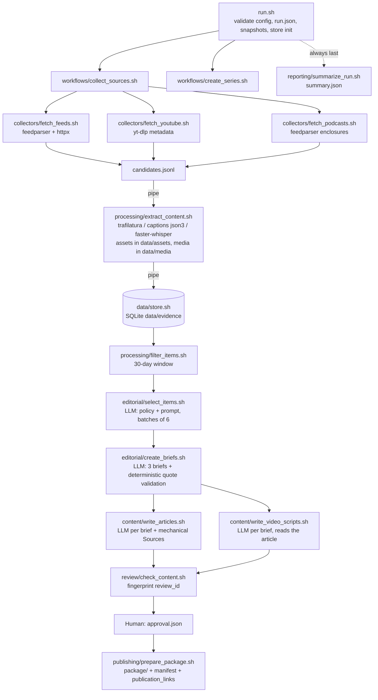

# Problem Set 4 Student Submission

Complete this document with your project details and links. Keep the course instructions in [README.md](README.md) and the required contracts in [ARCHITECTURE.md](ARCHITECTURE.md).

**Student:** Lingjie Pan (lingjie_pan@fas.harvard.edu)  
**GitHub repository:** [Jacquelineplj/ps04-harness-notes](https://github.com/Jacquelineplj/ps04-harness-notes) (private; course-staff access must be granted)

## Topic and Audience

- **Publication name:** Harness Notes
- **Topic:** Engineering the harness around AI agents: context management, tool protocols (including MCP), sandboxing and permissions, memory, evaluation and benchmarks, multi-agent orchestration, and observability.
- **Audience:** Engineers and technical leads building agent products or infrastructure (coding agents, computer-use agents, agent SDKs, MCP servers). They already know tool calling, context windows, evals, and sandboxing; fundamentals are not explained.
- **Central question:** What changed this month in how AI agent harnesses are built, evaluated, and operated, and which of those changes should practitioners act on?
- **Scope:** In — harness design (loops, context, compaction, memory, sub-agents), tool interfaces and protocols, in-harness safety rails, agent evaluation and harness-sensitive benchmark results, production operation (tracing, cost, reliability), and research measuring a harness design choice. Out — model releases or leaderboard scores with no harness implication, consumer product news, funding and event marketing, beginner tutorials and prompt tips, policy news unless it changes what a harness must enforce. Full rules: [config/editorial_policy.md](config/editorial_policy.md).
- **Reason to return:** Every edition is a dated, evidence-linked digest with an explicit as-of date — what changed since the last edition, which vendor claims held up, what to watch next, each claim linked to the exact passage or timestamp.

## Published Series

The three articles are free and public; the three companion videos were produced in Google Vids and published unlisted on YouTube. Each article links to its video; each video description links to its article and numbered sources. Anonymous HTTP checks on 2026-10-14 UTC returned 200 with the expected titles, as-of dates, and cross-links. [Production manifest](runs/20261013T213636Z-podcasts-expanded/production/manifest.json) · [verification results](runs/20261013T213636Z-podcasts-expanded/production/public_access_checks.json).

| Piece | Title | Substack article | YouTube video |
| --- | --- | --- | --- |
| 1 | The Harness Grew Up: What Changed in Agent Engineering This Month | [Read article](https://jacquelinepan.substack.com/p/the-harness-grew-up-what-changed) | [Watch video](https://youtu.be/4qUEXjaZM4Q) |
| 2 | Which Claims Held Up: Harnesses, Judges, and the Gap Between Passing and Working | [Read article](https://jacquelinepan.substack.com/p/which-claims-held-up-harnesses-judges) | [Watch video](https://youtu.be/bVXnraPti3g) |
| 3 | What To Build Next: State Ownership, Staged Autonomy, and the Audit Trail You Don't Have Yet | [Read article](https://jacquelinepan.substack.com/p/what-to-build-next-state-ownership) | [Watch video](https://youtu.be/pKNdJ5zOlJA) |

**Separate technical demonstration video:** [narrated walkthrough (Google Drive)](https://drive.google.com/file/d/1BbankDKDXPBOu0IHKyPOCsjyIaIJ_Huq/view?usp=sharing) — a narrated screen walkthrough of this repository and its runs, separate from the three audience-facing videos.

## Setup and Execution

Required tools (versions used):

- macOS with `/bin/bash` 3.2 — all scripts are bash-3.2 compatible
- `jq` 1.7, Python 3.12, `uv` 0.8 (or `pip`)
- Node 24 — used by yt-dlp as its JavaScript runtime for YouTube
- Claude Code CLI 2.1 (`claude`) for model calls
- No `ffmpeg`: audio is decoded by PyAV inside faster-whisper

```bash
# 1. Python dependencies in a project-local virtual environment
uv venv .venv --python 3.12
uv pip install --python .venv/bin/python -r requirements.txt
#    (pip alternative: python3 -m venv .venv && .venv/bin/pip install -r requirements.txt)

# 2. Model provider (default: Claude Code CLI, headless; uses your Claude login, no key file)
claude --version                     # must be installed and logged in
#    Alternatives, credentials via environment variables only:
#    export LLM_PROVIDER=anthropic ANTHROPIC_API_KEY=...   (official anthropic SDK)
#    export LLM_PROVIDER=openai    OPENAI_API_KEY=...      (official openai SDK)

# 3. Deterministic component checks from examples/README.md (disposable evidence dir)
bash tests/run_example_checks.sh

# 4. Live run, then human review, then packaging
bash run.sh                          # ends in awaiting_review; prints summary JSON
#    ... review runs/RUN_ID/articles, video_scripts, decisions; write runs/RUN_ID/approval.json
bash run.sh --package runs/RUN_ID    # reruns checks, builds runs/RUN_ID/package/

# Replay and demonstration modes
bash run.sh --replay runs/RUN_ID --label policy-v2          # same candidates, current config snapshot
bash run.sh --replay runs/RUN_ID --inject withheld.jsonl    # introduce a previously withheld candidate
SIMULATE_COLLECTOR_FAILURE=podcasts bash run.sh --label simulated-failure   # labelled collector failure
bash tools/trace_claim.sh runs/RUN_ID 01-c1                 # trace a claim to its passage
```

Environment variables (all optional): `LLM_PROVIDER` (claude-cli | anthropic | openai), `LLM_MODEL` (overrides every stage), `WHISPER_MODEL` (default `small`), `MAX_TRANSCRIBE_SECONDS` (default 3600 per episode), `RETAIN_MEDIA` (`0` deletes audio after transcription), `CAPTION_SLEEP_SECONDS`, `EXTRACT_REFRESH=1` (refetch written items in replay), `SIMULATE_COLLECTOR_FAILURE=<feeds|youtube|podcasts>[:after=N]`, `RUNS_DIR`, `EVIDENCE_DIR` (tests only). Credentials come only from `ANTHROPIC_API_KEY` / `OPENAI_API_KEY`; no credential is written to any file, snapshot, or log.

**Models** ([config/models.json](config/models.json)): `claude-sonnet-5` for bulk selection, `claude-opus-5` for briefs, articles and scripts — all through the Claude Code CLI with `--json-schema` structured output, our own system prompt, and `--tools ""` (no filesystem access). The CLI returns a list-price cost estimate per call, recorded in every receipt as `cost_is_estimate: true`.

**Configuration:** [config/project.json](config/project.json) (publication, topic, audience, central and series questions, scope), [config/sources.json](config/sources.json) (19 sources, 16 publishers; each with `perspective`, `independence_note`, `max_items`, `lookback_days`, podcast `max_duration_seconds`), [config/editorial_policy.md](config/editorial_policy.md), and four prompts in [prompts/](prompts/). `run.sh` validates these with `jq` before every run and snapshots them into `runs/RUN_ID/config` and `runs/RUN_ID/prompts`; every component reads only the snapshot.

## Architecture and Manual Handoffs



**Helpers.** Every required `.sh` is a real bash entry point that validates arguments, resolves the run directory and executes the Python implementation beside it (`collectors/fetch_feeds.py`, `data/store.py`, `review/check_content.py`, …). Shared plumbing in [lib/](lib/):

- `common.sh` — paths, logging, exit codes
- `receipt.py` — one receipt per invocation under `runs/RUN_ID/logs/`
- `llm.py` — provider wrapper and per-call usage log `logs/llm_calls.jsonl`
- `evidence.py` — retained-asset reading, verbatim quote matching, version hash, source-note rendering
- `sources.py` — feed fetching, URL canonicalisation, dates

Model calls happen in exactly four places — selection, briefs, articles, scripts — plus a cheaper "condense" call inside `create_briefs` for transcripts over 30k characters. Evidence lives in `data/evidence/evidence.sqlite` (items, versions, observations), touched only by `data/store.sh`; text and transcript segments are content-addressed files under `data/assets/<kind>/<item16>/<version12>.*`.

Manual handoffs after `awaiting_review`:

1. **Human editorial review.** In: `runs/RUN_ID/articles/*.md`, `video_scripts/*.md`, `briefs.jsonl`, `decisions.jsonl`, `review.json` (warnings flag what needs judgement). Out: `approval.json` with the current `review_id`, `decision`, `reviewer`, `reviewed_at`, `notes`. Corrections are made in place and invalidate the fingerprint, so `bash run.sh --package` reruns the checks.
2. **Video production (Google Vids or HeyGen).** In: `package/NN-video-script.md` (scenes with Visual / On-screen text / Narration). Out: an MP4 per piece.
3. **Substack.** In: `package/NN-article.md` (markers resolved to numbered references, Sources section, as-of and AI-assistance lines). Out: the article URL.
4. **YouTube.** In: the MP4 and `package/NN-youtube-description.txt` (numbered source links and timestamps; add the Substack URL). Out: the video URL, then linked from the article.
5. **Record links** in `package/publication_links.json` and rerun `bash run.sh --package runs/RUN_ID`; links are preserved and reported in `summary.json` separately from production readiness.

## Evidence and Runs

All runs live under [runs/](runs/) (index in [runs/README.md](runs/README.md)). Each run directory holds `run.json`, the config and prompt snapshots, every receipt under `logs/` (one JSON per stage invocation plus `llm_calls.jsonl`), the JSONL artifacts named in ARCHITECTURE.md, the drafts, `review.json`, and `summary.json`.

- **Evidence index:** [data/evidence/evidence.sqlite](data/evidence/) — tables `items`, `versions`, `observations`; only `data/store.sh` writes it, and `bash data/store.sh list` or `get ITEM_ID [VERSION_ID]` reads it.
- **Retained assets:** [data/assets/](data/assets/) — text and timestamped transcript segments at `<kind>/<sha256(item_id)[:16]>/<version_id[:12]>.txt|.segments.json` (100 files, 2.9 MB).
- **Original media:** caption tracks and feed bodies are committed under [data/media/](data/media/); audio is not — see [data/media/README.md](data/media/README.md) for retrieval via each item's stored `media_url`.

Final published run: **[runs/20261013T213636Z-podcasts-expanded/](runs/20261013T213636Z-podcasts-expanded/)** — `decisions.jsonl` (67 decisions), `briefs.jsonl`, `articles/`, `video_scripts/`, `review.json`, `editorial_review.md`, `corrections.jsonl`, `approval.json`, `package/`.

| Run | Actual date | Run artifacts and logs | Elapsed time | Approximate cost |
| --- | --- | --- | --- | --- |
| First live run (attempt 1) | 2026-10-13 | [runs/20261013T204414Z/](runs/20261013T204414Z/) — 69 candidates, 60 items extracted and stored (14 caption tracks, 6 podcasts, 4.25 h transcribed), then the collection workflow crashed on a bash-3.2 `PIPESTATUS` bug before `corpus.jsonl`; recorded in `logs/collect_sources-*.json` (post-hoc receipt, labelled) | 38 min | $0 model cost (no model stage reached); local compute only |
| First live run (attempt 2) | 2026-10-13 | [runs/20261013T212217Z/](runs/20261013T212217Z/) — after the fix: 59 `unchanged` + 1 `new`, 59 eligible, 23 accepted, 3 briefs/articles/scripts; **content checks failed**: no podcast evidence cited because every podcast episode in the corpus was off-topic and rejected (`review.json`, one error) | 13 min | $4.07 (estimate, list price) |
| **First live run (final, published)** | 2026-10-13 | [runs/20261013T213636Z-podcasts-expanded/](runs/20261013T213636Z-podcasts-expanded/) — podcast discovery widened (keyword pre-filter, two more sources); 74 candidates, 65 items (9 `new`, 56 `unchanged`), 67 eligible from 16 publishers (38 feed / 15 YouTube / 14 podcast), 27 accepted, checks passed, human review and corrections, approved, packaged (`ready_for_production`) | 81 min to `awaiting_review` (plus human review and later packaging/link updates; `summary.json` wall time includes those updates) | $5.12 (estimate, list price; 23 model calls, 1.16 M input tokens) |
| Policy revision replay | 2026-10-13 | [runs/20261013T230227Z-policy-v2/](runs/20261013T230227Z-policy-v2/) — `--replay` of the final run with policy v2, stopped after selection; 65/65 `unchanged`; decisions 30/36/1 vs 27/33/7; diff in `decisions_diff.md` | 5 min | $1.08 (estimate) |
| Injected-item replay | 2026-10-14 (UTC) | [runs/20261014T005413Z-inject-withheld/](runs/20261014T005413Z-inject-withheld/) — `--replay` of the final run plus [demo/withheld_candidate.jsonl](demo/withheld_candidate.jsonl) (a real Interconnects post deliberately kept out of `config/sources.json`); `changes.jsonl`: 65 `unchanged`, 1 `new`; extraction reused 65 items and transcribed nothing; the injected item was judged by the policy (rejected as general opinion) | 5 min | $1.09 (estimate) |
| Simulated collector failure | 2026-10-14 (UTC) | [runs/20261014T005920Z-simulated-failure/](runs/20261014T005920Z-simulated-failure/) — `SIMULATE_COLLECTOR_FAILURE=podcasts`, `--until collect`: the podcast collector emitted 3 candidates from its first source, then exited 1 with an error marked `simulated: true`; feeds and YouTube completed; the workflow continued (66 candidates, 73 eligible) and `summary.json` reports `coverage_complete: false`, the failed collector and the simulated flag | 5 min | $0 (no model stage) |
| Second live run | 2026-10-14 UTC | [runs/20261014T014037Z-second-live/](runs/20261014T014037Z-second-live/) — 0 new / 0 changed / 67 unchanged; 73 eligible; 27 accepted; 3 briefs/articles/scripts; checks pass with 5 editorial warnings; human approved and packaged (`ready_for_production`) | 15 min 18 sec to awaiting review | $5.20 (estimate, list price) |
| **Additional live run on a different New York day** | **2026-10-14 New York / 2026-10-15 UTC** | [runs/20261015T014725Z-ny-next-day-live/](runs/20261015T014725Z-ny-next-day-live/) — 74 candidates, 67 extracted; 20 new / 2 changed / 45 unchanged; 93 eligible; 35 accepted / 50 rejected / 8 deferred; 3 briefs/articles/scripts. Collection, editorial, drafting and content-check stages completed; 0 content errors / 3 human-review warnings after logged AI edits. Six omitted model decisions are explicitly deferred; source access/truncation limits are documented in editorial_review.md. Status `awaiting_review`, no human approval claimed | **26 min 21 sec** to awaiting review | **$6.93** (CLI list-price estimate) |

Costs are the Claude Code CLI's own list-price estimates, recorded per call (`cost_is_estimate: true`). The subscription is not billed per token, so the true marginal cost is unknown; `summary.json` reports it under `costs.estimated_usd` with `known_usd: 0`. Local transcription and all other stages are reported at cost 0 with `cost_basis: local compute`.

**Different-local-day requirement resolved.** The first published live run began 13 October at 17:36:36 EDT; the additional complete live run began 14 October at 21:47:25 EDT (15 October 01:47:25 UTC) — different New York dates, more than 24 hours apart. [Time-zone evidence](runs/20261015T014725Z-ny-next-day-live/execution_timezone.json) · [decision/argument comparison](runs/20261015T014725Z-ny-next-day-live/decisions_diff.md) · [AI-assisted review preparation](runs/20261015T014725Z-ny-next-day-live/editorial_review.md). The new drafts await human approval; the submitted series remains the three approved publications.

**Second-live-run comparison.** Both runs started 13 October in America/New_York, so their UTC execution dates differ (13 and 14 October) without being 24 hours apart. The second run found no new or changed evidence and reused all 25 media transcripts, but intervening runs had grown the store, so 73 items were eligible rather than 67. Under policy v2: 27 accepted, 45 rejected, 1 deferred. The new briefs cite 3 distinct podcasts instead of 1, and shift piece 1 toward the harness experiment and piece 2 toward conditional snapshot results ([decision comparison](runs/20261014T014037Z-second-live/decisions_diff.md)). Validation dropped an unlocatable claim from brief 02. Lingjie Pan reviewed and approved the edited drafts; the run is packaged as `ready_for_production`.

**What changed between runs.** Attempt 1 discovered and stored everything. Attempt 2 added one newly published article (`feed:…` in `changes.jsonl`) and re-observed 59 items unchanged — evidence that the version hash is stable across re-fetches of written pages. The final run added 9 podcast episodes as `new` and reused 56 items, re-transcribing none of 19 media transcripts (`extract_content` receipt: `reused: 56, fetched: 18`). The policy replay observed 65/65 unchanged. Per-run unknown or estimated costs are in `summary.json → costs`.

**Duplicate handling.** `changes.jsonl` for attempt 2 and the final run shows `unchanged` for every re-observed item and `new` only for genuinely new material. `data/store.sh` was also verified against `examples/` with `tests/run_example_checks.sh`: duplicate input lines and refreshed `retrieved_at` produce `unchanged`; a changed transcript produces one `changed` version while the earlier version stays retrievable. No podcast/YouTube pair of the same recording occurred in the window, so the reconciliation rule (`duplicates.jsonl`, `aliases`) stayed empty — it is documented in `processing/extract_content.py`.

**Date-window checks.** Every run's `exclusions.jsonl` records items outside the 30-day window as `outside_window` with exact dates (for example a 22 August and a 4 September post in the final run; window 14 September – 13 October). The fixture check covers `unknown_date`, `future_date` and `invalid_date`.

**Collection failure and recovery.** Attempt 1 is a genuine failure — collector outputs preserved, store populated, workflow aborted, receipt written after the fact and labelled `written_post_hoc` — recovered by attempt 2 without re-transcribing anything. Attempt 2 is a genuine *editorial* failure: the pipeline refused to publish without podcast evidence rather than inventing it. The `simulated-failure` run demonstrates a labelled collector failure: `collection_status.json` records the podcast collector's exit 1 and `simulated: true`, its receipt carries the simulated error, the other collectors' results were kept, and `summary.json` lists `collector:podcasts` under `failed_or_incomplete_stages` with `coverage_complete: false`. Every OpenAI article page returned HTTP 403 in all runs; those items are recorded as inaccessible in the extraction receipts rather than silently dropped.

**Claim trace** (`bash tools/trace_claim.sh runs/20261013T213636Z-podcasts-expanded 03-c9`). Claim `03-c9` — "a practitioner reports AWS has roughly 16,000 APIs, too many to model as tools, pushing them toward code-mode execution that is itself hard for humans to review", type `source_claim` → brief 03 → editorial decision `accept` for pieces 01/02/03 on item `podcast:8d8927fb57f7e934` (MLOps Community, *AWS Has 16,000 APIs. Can MCP Handle It?*, published 2026-09-28) → stored version `72917d775f28…` → transcript segments `s-0068` (30:48–31:17) and `s-0034` (15:01–15:29) in `data/assets/podcast/93cf1193e6ac377f/72917d775f28.segments.json` → cited in `articles/03.md` ("noted at 30:48 … conceded at 15:01") and resolved in `package/03-sources.md` with the episode link and timestamps.

## Editorial Review

**Policy and prompts:** [config/editorial_policy.md](config/editorial_policy.md) (v2, current) and [prompts/](prompts/). The v1 policy that produced the published run is preserved in [its run snapshot](runs/20261013T213636Z-podcasts-expanded/config/editorial_policy.md); the v2 snapshot is [here](runs/20261013T230227Z-policy-v2/config/editorial_policy.md).

**Decision review** of four accepted and five rejected or deferred items, comparing the AI's reasons with my own: [editorial_review.md](runs/20261013T213636Z-podcasts-expanded/editorial_review.md). I agreed with seven of nine, partly with one, and disagreed with one — the deferral of the Latent Space episode with an Anthropic Claude Code engineer, which selection judged from sampled transcript excerpts that happened not to show harness content.

**Policy revision (v1 → v2)** — three changes, each traced to a reviewed decision or correction:

1. Audio/video items are judged on the whole episode when the title, guest or description names a harness product.
2. Newsletter roundups count as secondary reporting and are deferred by default.
3. Authorship is taken from the article body, not from feed-level author fields.

Effect on the same evidence (`decisions_diff.md`): 52 of 67 decisions identical; the Claude Code episode moved defer → accept (01, 03); two more deferrals became accepts and three became rejects; the rest are piece reassignments. The replay stopped after selection (`--until select`) so the comparison isolates the affected stage.

**Factual corrections** — all 43 recorded with before/after text and reasons in [corrections.jsonl](runs/20261013T213636Z-podcasts-expanded/corrections.jsonl):

- The martinfowler.com harness experiment was attributed to Martin Fowler because the feed's author field names the site owner; the retained text identifies Naresh Jain, so briefs, article 02 and script 02 were corrected.
- Article 03 referred to "our last edition", which does not exist; it now refers to piece 02.
- Articles 02/03 and script 02 were trimmed to the length targets without removing a claim or marker.
- Two quotes from an arXiv PDF were normalised to the retained wording (line-break hyphenation) by the validator and checked by hand.

**Approval evidence:** [review.json](runs/20261013T213636Z-podcasts-expanded/review.json) (passed, 0 errors, 5 reviewed warnings) and [approval.json](runs/20261013T213636Z-podcasts-expanded/approval.json) carry the same `review_id`; `bash run.sh --package` recomputed the fingerprint before building [package/](runs/20261013T213636Z-podcasts-expanded/package/).

## Reflection

**One insight the system produced.** Piece 02's central conditional appears in no single source. A Thoughtworks-hosted experiment found a behavioural harness added only cost for a frontier model but took a cheaper model from 3/10 to 10/10; the sandbox-snapshot paper found full-machine restoration helps only when progress lives outside the repository; Microsoft's skills-over-MCP post found a smaller initial context is not automatically a cheaper conversation. Read together: harness machinery pays exactly when it supplies information the model or the repository does not already have. The brief stage produced that synthesis as an explicit `inference` claim with three locators, and the article labels it as interpretation.

**One editorial failure or limitation.** The system attributed Naresh Jain's experiment to Martin Fowler. The cause was structural: the feed collector copies the feed-level `author`, the selection prompt saw "Martin Fowler" in the metadata header before the text, and every later stage inherited the reason. Mechanical checks catch unresolvable quotes, not semantically wrong attributions; human review caught it. A second limitation: selection judges long transcripts from sampled excerpts, which deferred the single most relevant podcast episode. Policy v2 narrows that, but the real fix is to let selection read a condensed full transcript.

**Next improvement.** Move the transcript-condensing call (currently only in `create_briefs`) in front of selection, so every media item is judged on a model-written excerpt map of the whole episode, and store that map as a retained asset so it is cited like any other segment.

**Architectural tradeoff.** The evidence store is a SQLite index of *records* plus content-addressed asset files, rather than text in the database. Version ids hash title, URL, date, text and segments and exclude retrieval time, so a refetched unchanged page is `unchanged`, a re-upload with a new date is a new version with the old one still retrievable, and every citation names a version whose file cannot be overwritten. The cost is duplication when metadata changes (a retitled video stores a second copy of an identical transcript) and a reuse rule that must be explicit (`extract_content` reuses media transcripts through `store.sh list` and re-transcribes only when the stored transcript was capped shorter than now allowed). For a publication whose value is that every claim traces to an exact passage, immutable versioned assets are the right side of that tradeoff.
